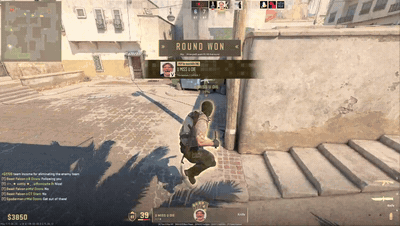
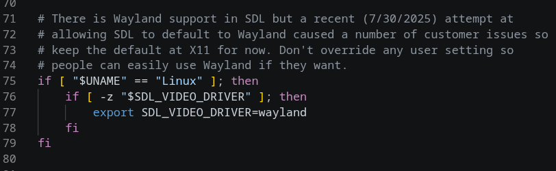

# fix-cs2-wayland

One-command fix for two related CS2 (Counter-Strike 2, native Linux) bugs on
Wayland desktops — Ubuntu Steam Snap in particular. No root, no python.

Current version: **v1.0.0** (see `fix-cs2-wayland --version`).

## Origin

This fix was created after a **clean Ubuntu install (Steam Snap, GNOME
Wayland)** reproduced the stuck-mouse bug minutes into the first CS2 launch —
same symptom everyone else reports. Searching found several threads and
workarounds (restart CS2 and hope, switch to X11, gamescope, Xorg session
…), but no real fix; every suggestion either failed to launch CS2 on the
Snap or left the bug. The workspace was instrumented instead: the running
game's container was inspected, SDL initialization was tested directly
inside the Steam Linux Runtime, and the two-part root cause below was
confirmed — this script is what came out of that.

## Symptoms it fixes

1. **Mouse barely moves in-game** (stuck near center, only a few mm of movement,
   random per launch) — tracked at
   [ValveSoftware/csgo-osx-linux#4354](https://github.com/ValveSoftware/csgo-osx-linux/issues/4354)
   and [libsdl-org/SDL#16163](https://github.com/libsdl-org/SDL/issues/16163).
   Root cause: CS2's launcher forces `SDL_VIDEO_DRIVER=x11`, which on a Wayland
   desktop means XWayland, and CS2's bundled SDL3 mis-decodes XInput2 relative
   valuators there.
2. **CS2 won't launch after changing it to `wayland` on Ubuntu's Steam Snap.**
   Root cause: the Snap sets `DISABLE_WAYLAND=1` and
   `XDG_RUNTIME_DIR=/run/user/$UID/snap.steam` and never links the real
   Wayland socket there, so Steam's container runtime
   (`SteamLinuxRuntime_sniper` / pressure-vessel) drops the socket and
   CS2 exits on startup.

## See the bug

*(Video clip and screenshots by [u/Pretty_Library_2373](https://www.reddit.com/user/Pretty_Library_2373/) — reused with credit from the original report. If you are the author and would prefer they not be hosted here, open an issue and they will be removed immediately.)*

The 12-second demo below is the exact in-game portion of the original 84-second Reddit video: crosshair up, camera stuck, aim barely able to turn:



The full 84-second clip untouched (video by u/Pretty_Library_2373): [`docs/media/mouse-bug-linux-native.mp4`](docs/media/mouse-bug-linux-native.mp4) — or watch it on the original Reddit thread (linked below).

How the launcher forces X11 on Wayland desktops (`game/cs2.sh`):



Reference — the original report (r/cs2, May 14 2026):

- Thread: <https://www.reddit.com/r/cs2/comments/1td29d6/mouse_bug_linux_native/>
- Video: <https://v.redd.it/tnzdwqp6i41h1>
- Full post screenshot: [`docs/media/original-post-screenshot.png`](docs/media/original-post-screenshot.png)

## Fix status upstream (checked 2026-11-01)

| Layer | Status |
|---|---|
| SDL bug itself ([libsdl-org/SDL#16163](https://github.com/libsdl-org/SDL/issues/16163)) | **Fixed** — merged 2026-09-10 ([PR #16267](https://github.com/libsdl-org/SDL/pull/16267)), shipped in SDL 3.4.18 |
| Steam Linux Runtime sniper ([steam-runtime#857](https://github.com/ValveSoftware/steam-runtime/issues/857)) | **Closed** 2026-10-23 — sniper platform 3.0.20261021 now ships `libSDL3.so.0.4.18` (verified in the installed runtime) |
| CS2 ([csgo-osx-linux#4354](https://github.com/ValveSoftware/csgo-osx-linux/issues/4354)) | **Still open**, reports continuing into November 2026 |

Why CS2 is still broken even though the runtime fix shipped: **CS2 does not use the runtime's SDL.** It statically paths to its own bundled copy at `game/bin/linuxsteamrt64/libSDL3.so.0` (a `3.5.0-HEAD`-era build). Until Valve updates that copy or removes the `SDL_VIDEO_DRIVER=x11` default from `cs2.sh`, the bug persists — which is precisely why people kept reporting the problem after #857 was closed. This script sidesteps the buggy X11 path entirely by forcing native Wayland (where the bug does not exist).

## What it does

- Sets `export SDL_VIDEO_DRIVER=wayland` in `game/cs2.sh` (only on Wayland sessions).
- Creates `$XDG_RUNTIME_DIR/snap.steam/$WAYLAND_DISPLAY -> ../$WAYLAND_DISPLAY`
  and installs a small oneshot user systemd unit so it survives reboots.
- Patches `SteamLinuxRuntime_sniper/_v2-entry-point` to create that symlink
  itself before the container is built (covers Snaps with the disabled bridge).
- Saves a `.backup-before-wayland-fix` copy next to every file it touches.
- Re-running is safe (idempotent), and it repairs itself after CS2 or
  Steam Runtime updates.

## Display mode: fullscreen vs borderless

The script deliberately **does not touch** CS2's display-mode settings
(`~/…/userdata/<UID>/730/local/cfg/cs2_video.txt`); it only fixes where the
game runs (Wayland vs XWayland). On the author's setup the final state is
**borderless** (`fullscreen=0`, `nowindowborder=1`), chosen for these
reasons:

- **True fullscreen was the unreliable mode before the fix.** While CS2 was
  running on XWayland, forcing true exclusive fullscreen produced
  launch-to-launch chaos: sometimes severe input lag or the stuck-mouse bug,
  sometimes the desktop's GNOME top bar/menus remained visible over a
  "fullscreen" game, sometimes the game reverted to borderless on its own
  next launch (and the config values set did not reliably stick — CS2
  rewrites `cs2_video.txt` itself at launch).
- **Borderless was the only mode that behaved predictably** on the Wayland
  desktop (with the cosmetic cost that GNOME's top bar and dock stay clickable).
- **Important caveat:** all pre-fix fullscreen experiments happened while
  CS2 was still actually on X11/XWayland (the bug that stalled it). Now that
  CS2 runs on real Wayland, exclusive fullscreen may behave completely
  differently — it simply has not been retested on this machine yet.

**Community test (voluntary):** after applying this fix, if you were affected
by the lag-with-fullscreen symptom, try switching Settings → Video to real
Fullscreen (with the script installed, i.e. on native Wayland), play a round,
and compare input lag vs borderless; then report your result on the issue
thread above. Any finding — better, same, or worse — is useful data for the
csgo-osx-linux#4354 discussion. Your `cs2_video.txt` is user-owned config:
note its values before experimenting (see the `--status` output above for the
paths we manage, or back the file up manually).

## Install

```bash
mkdir -p ~/.local/bin
cp fix-cs2-wayland ~/.local/bin/
chmod +x ~/.local/bin/fix-cs2-wayland   # adjust PATH if needed
```

## Usage

```bash
fix-cs2-wayland            # apply (default); safely skips pure X11 sessions
fix-cs2-wayland --status   # inspect without changing anything
fix-cs2-wayland --revert   # restore all backups, remove service + symlink
fix-cs2-wayland --force    # apply even without a Wayland session detected
STEAM_DIR=/games/Steam fix-cs2-wayland   # override library discovery
```

## Supported setups

| Install         | Detected via                                   | Notes                                  |
|-----------------|------------------------------------------------|----------------------------------------|
| Native (deb/rpm)| `~/.local/share/Steam`, `~/.steam/steam`       | No Snap bridge installed               |
| Ubuntu Snap     | `~/snap/steam/common/.local/share/Steam`       | Bridge + service + entry-point patch   |
| Flatpak         | `~/.var/app/com.valvesoftware.Steam/...`       | No Snap bridge installed               |
| Custom libraries| `libraryfolders.vdf` or `STEAM_DIR`            | All libraries scanned                  |

## Troubleshooting

- **Still stuck mouse after applying?** Fully quit CS2 and Steam, launch Steam
  again, and verify with `--status` that `cs2.sh` shows
  `SDL_VIDEO_DRIVER=wayland` and the entry point shows `patched`.
- **CS2 crashes on Wayland after an update?** `fix-cs2-wayland --revert`
  restores the stock behaviour; the mouse bug returns with it.
- Launch CS2 once from a terminal via Steam ("Launch in a terminal") if you hit
  a different failure; the Valve wayland backend needs a running Wayland
  compositor (GNOME/KDE/Sway etc.).

## Feedback

Works for you? Please say so on the
[issue thread](https://github.com/ValveSoftware/csgo-osx-linux/issues/4354) and in the
[Reddit thread](https://www.reddit.com/r/cs2/comments/1td29d6/mouse_bug_linux_native/) —
Valve needs to know how many players this affects.
Problems? Open an issue with the output of `fix-cs2-wayland --status`.

## Tested On
- Ubuntu 26.10 (GNOME Wayland, XDG_SESSION_TYPE=wayland)
- Steam Snap 1.0.0.87 (core24), SteamLinuxRuntime_sniper 3.0.20261021.x
- CS2 native Linux client, bundled `libSDL3.so.0` (`3.5.0-HEAD` as of 2026-10)
- AMD RADV (GFX11); NVIDIA/other GPU reports welcome

## License

MIT (see [LICENSE](LICENSE))
